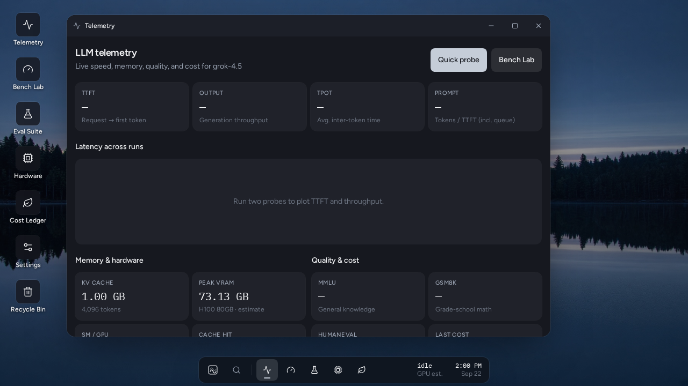
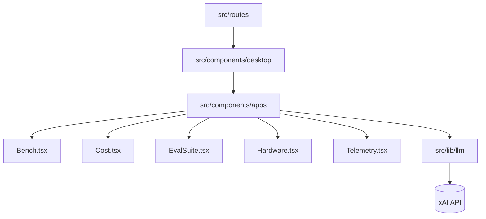
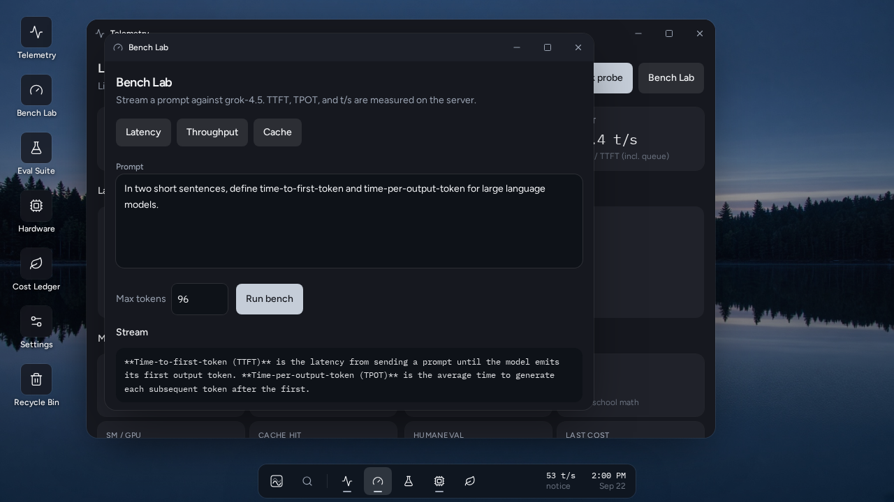
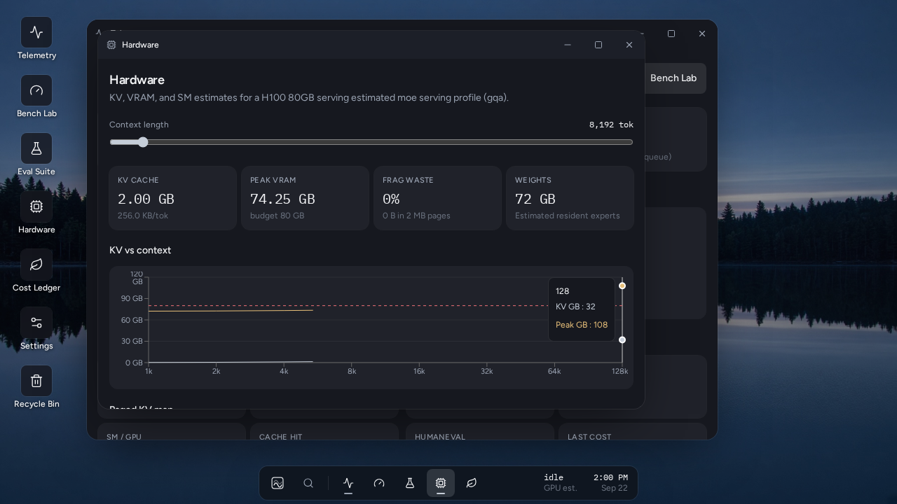

# Helix

Windows-style desktop for measuring LLM speed, hardware, quality, and cost.




## Features

- **Telemetry** — live Quick Probe for TTFT, TPOT, and tokens/sec
- **Hardware** — KV cache, VRAM estimates, fragmentation, GPU/CPU
- **Bench Lab** — streaming latency and throughput runs
- **Eval Suite** — MMLU / GSM8K / HumanEval / RAG slices
- **Cost Ledger** — energy and API cost per token

## Architecture


The architecture uses a central TanStack Router setup in `src/routes` which hosts the main desktop environment component from `src/components/desktop`. Within the desktop interface, individual windowed applications like `Bench.tsx`, `Hardware.tsx`, and `Telemetry.tsx` live in `src/components/apps`. These components interact with background services and external endpoints via shared functionality in `src/lib/llm`.

## Quick start

Requires Node.js 22. Run the application or test it locally using standard npm commands:

```bash
npm install
npm run dev
npm run build
npm test
npm run typecheck
npm run lint
```

## Configuration

| Variable | Purpose | Default |
| --- | --- | --- |
| `XAI_API_KEY` | xAI API key for live Grok probes, evaluations, and measurements. | _None_ |
| `DATABASE_URL` | Optional Postgres connection string; when unset, local/preview builds use the PGLite fallback and npm run build skips migrations. | _None_ |
| `VITE_AUTH_ENABLED` | Feature flag to enable or disable authentication routes and flow. | `false` in .grok/app-env.json for local dev; auth is on if unset. Read by dev/build/preview via scripts/with-app-env.mjs. |

## Screenshots




## Roadmap

- See issues.

## License & credits

Unlicensed.
